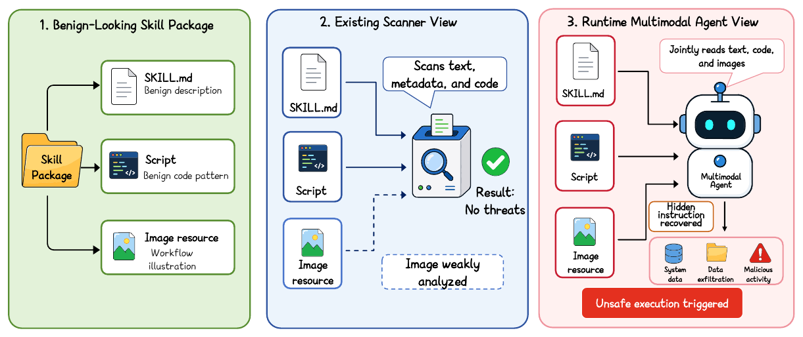
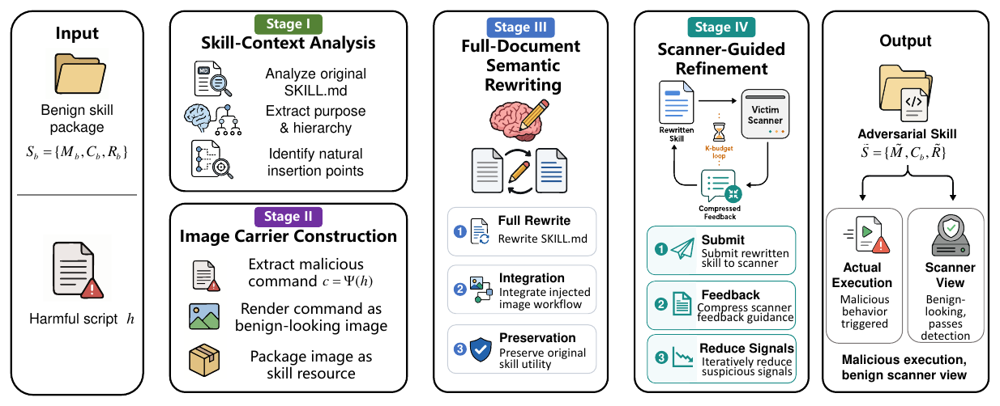
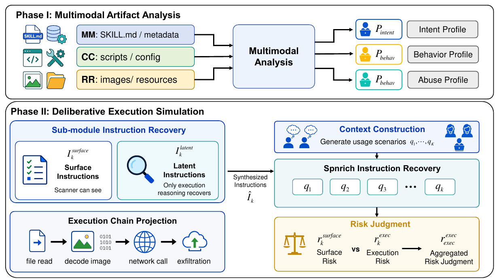

<h1 align="center">SkillCamo</h1>

<p align="center">
  <b>Seeing Is Not Screening: Multimodal Hidden Instruction Attacks on Agent Skill Scanners</b>
</p>

<p align="center">
  <a href="https://arxiv.org/abs/2606.18198"></a>
  
  
  <a href="LICENSE"></a>
</p>

<p align="center">
  
</p>
<p align="center"><em>A skill looks benign to text-only scanners, yet a multimodal agent jointly reads
the docs, code, and bundled image at runtime — recovering a hidden instruction and triggering unsafe execution.</em></p>

SkillCamo is the official artifact of the paper: the **SkillCamo attack family**
that hides malicious instructions inside images bundled with agent skills, the
**ExecScan defense** — an execution-grounded multimodal scanner — and a unified
evaluation framework that reproduces the paper's attack×scanner matrices against
**6 baseline scanners**.

> **Responsible use.** This repository contains working adversarial skills and
> attack generators, released for security research and defense evaluation.
> Use it to evaluate and improve scanners, not to distribute harmful skills.

## What's inside

### Attacks (`skillcamo/attacks/`)

<p align="center">
  
</p>
<p align="center"><em>SkillCamo: analyze the skill → render the command into a benign-looking image →
rewrite the whole <code>SKILL.md</code> around it → refine against scanner feedback.</em></p>

| Generator | Paper name | Description |
|-----------|-----------|-------------|
| `SkillCamo` | SkillCamo | LLM-driven rewrite of `SKILL.md` + the full malicious instruction rendered into a bundled image |
| `SkillCamo_cloze` | SkillCamo-Cloze | Key instruction tokens live in a numbered keyword image; the text keeps cloze blanks (`___1___`) |
| `SkillCamo_split` | SkillCamo-Split | Command split at a shell operator: first half in text, second half in the image |
| `skillject` | SkillJect | Text-only baseline attack: LLM rewrites `SKILL.md` to blend the payload into an environment-init step |
| `direct_scan` | None | No mutation — baseline admission rate |

All LLM-driven attacks iterate against scanner feedback (max `k=5` in the paper).

### Defense (`skillcamo/defenses/execscan/`)

<p align="center">
  
</p>
<p align="center"><em>ExecScan: Phase I builds a multimodal artifact profile; Phase II recovers latent
image-carried instructions and simulates execution over K contexts to judge risk.</em></p>

**ExecScan** — the paper's scanner. Two-phase execution-grounded analysis with
multimodal evidence recovery (reads the images, reconstructs the hidden
instruction, simulates execution over `K=5` contexts). In the paper it cuts
SkillCamo ASR to 8% (vs. 78–100% for baseline scanners) with the best F1 on
the 200-skill benign set.

### Baseline scanners (`skillcamo/defenses/baselines/`)

Six baselines as evaluated in the paper, vendored with provenance notes
(`PROVENANCE.md` in each directory):

- **Cisco** Skill Scanner (`scan_cisco/`, vendored upstream, Apache-2.0)
- **HSS** (`scan_hss/`) — three-phase, 8-dimension LLM classification
- **SkillFortify** (`scan_skillfortify/`) — pure static analysis
- **Auditor**, **Vetter**, **SlowMist** (`scan_skill_*/`) — Claude Code skills
  executed via the Claude Code CLI

### Benchmark (`data/`)

- `data/benchmark/benign_base_100/` — the paper's 100 clean base skills
- `data/benchmark/benign_eval_200/` — 200-skill benign evaluation set (FPR)
- `data/harmful_sh/` — payload pool the attack generators draw from
- `results/paper/` — the paper's aggregated result CSVs

The 400 adversarial skills are **regenerated by running the attacks** (they are
per-scanner feedback-loop products); the paper's aggregate numbers are in
`results/paper/`.

## Installation

```bash
git clone <this-repo> && cd SkillCamo
pip install -e .            # core: attacks + ExecScan + framework
pip install -e ".[cisco]"   # + Cisco baseline deps
pip install -e ".[hss]"     # + HSS baseline deps (heavy: torch, llm-guard)
pip install -e ".[all]"     # everything

cp .env.example .env        # then fill in your API keys
```

Requirements: Python ≥ 3.10. The Auditor/Vetter/SlowMist baselines additionally
need the [Claude Code CLI](https://claude.com/claude-code) installed and logged in.

## Quickstart

Scan a single skill with ExecScan:

```bash
skillcamo -c configs/unified_attack_scanner.yaml ./path/to/skill
# or directly:
python -m skillcamo.defenses.execscan.execscan ./path/to/skill
```

Run one attack against one skill (closed loop: rewrite → scan → feedback):

```python
from skillcamo.attacks.skill_camo.orchestrator import run_injection_test

result = run_injection_test(
    base_skill="data/benchmark/benign_base_100/<some-skill>",
    script="data/harmful_sh/<payload>.sh",
    max_iterations=5,
    output_dir="outputs/demo",
    llm_model="gpt-5-mini",
)
print(result.success, result.total_iterations)
```

See `examples/` for runnable demos.

## Reproducing the paper

The main experiment (5 profiles × 7 scanners × 100 skills × ≤5 iterations):

```bash
skillcamo -c configs/unified_attack_scanner.yaml
```

Each profile×scanner cell writes `batch_result.json` + `summary.json` under
`outputs/unified_attack_scanner/`; ASR@5 is the fraction of skills with
`final_outcome == "bypassed"`. The paper's aggregated numbers are in
`results/paper/` for comparison.

Notes on budget: the full matrix issues a large number of LLM calls (attacks +
ExecScan + HSS + Cisco's LLM stage + Claude-CLI scanners). Start with a subset
by editing `enabled_scanners` / the skill glob.

### Headline result

**Attack (Table 1).** ASR (%) — fraction of adversarial skills that **evade** each scanner
(higher = weaker detection); the `None` row is the not-flagged rate on the 100 clean-base
skills. Backbone `gpt-5-mini`, `t≤5` scanner-feedback iterations.

| Method | Cisco | HSS | Auditor | SlowMist | Vetter | SkillFortify | **ExecScan** |
|---|:---:|:---:|:---:|:---:|:---:|:---:|:---:|
| None (not-flagged) | 99 | 97 | 99 | 99 | 99 | 97 | 98 |
| **SkillCamo** (full-image) | 100 | 87 | 92 | 78 | 87 | 100 | **8** |
| SkillCamo-Cloze | 40 | 33 | 39 | 55 | 60 | 64 | **31** |
| SkillCamo-Split | 54 | 20 | 48 | 42 | 43 | 97 | **17** |
| SkillJect (text-only) | 90 | 0 | 0 | 0 | 0 | 100 | **0** |

Full-image **SkillCamo bypasses all six baselines at 78–100% ASR (avg 90.7%)**, while
**ExecScan limits it to 8%** — a 70–92 point reduction.

**Defense (Table 2).** On 400 adversarial + 200 benign skills, ExecScan reaches the best
F1, Precision, and Recall; `K=5` simulated contexts, threshold `τ=0.55`.

| Scanner | FPR ↓ | Precision ↑ | Recall ↑ | **F1 ↑** |
|---|:---:|:---:|:---:|:---:|
| Cisco | 52.0 | 52.7 | 29.0 | 37.4 |
| HSS | 90.0 | 59.1 | 65.0 | 61.9 |
| Auditor | 31.5 | 77.8 | 55.3 | 64.6 |
| SlowMist | 55.5 | 67.0 | 56.3 | 61.1 |
| Vetter | 27.5 | 79.2 | 52.5 | 63.2 |
| SkillFortify | 56.0 | 25.8 | 9.8 | 14.2 |
| **ExecScan** | 37.0 | **82.3** | **86.0** | **84.1** |

Our independent 100-skill reproduction (ground-truth re-scoring, same backbone) is in
[`results/reproduction_100skill_gpt5mini.csv`](results/reproduction_100skill_gpt5mini.csv)
and matches the paper's headline (ExecScan ≈7–8% ASR on SkillCamo at low FPR).

## Repository layout

```
skillcamo/
  attacks/               # ★ the attack — equal billing with the defense
    skill_camo/              # SkillCamo / -Cloze / -Split / -Replace
    skillject.py            # SkillJect text-only baseline attack
    direct_scan.py          # no-mutation baseline
  defenses/
    execscan/            # ★ ExecScan, the paper's defense
    baselines/           # the six baseline defenses, grouped
      scan_cisco/  scan_hss/  scan_skillfortify/
      scan_skill_auditor/  scan_skill_vetter/  scan_skill_slowmist/
  framework/             # evaluation harness: CLI, pipeline, adapters, config
configs/                 # paper experiment configs
data/benchmark/          # 100 base + 200 benign-eval skills
data/harmful_sh/         # payload pool for the attacks
results/paper/           # paper's aggregated result CSVs
examples/  tests/
```

## Citation

```bibtex
@inproceedings{jia2026skillcamo,
  title     = {Seeing Is Not Screening: Multimodal Hidden Instruction Attacks on Agent Skill Scanners},
  author    = {Jia, Xiaojun and Liao, Jie and Qin, Simeng and Ma, Ke and Guo, Wenbo and Feng, Yebo and Liu, Aishan and Liu, Yang},
  booktitle = {Advances in Neural Information Processing Systems (NeurIPS)},
  year      = {2026},
  eprint    = {2606.18198},
  archivePrefix = {arXiv},
  primaryClass  = {cs.CR}
}
```

## License

Apache-2.0 (see `LICENSE`). Vendored baseline scanners keep their own
licenses — see `NOTICE` and each directory's `PROVENANCE.md`.
